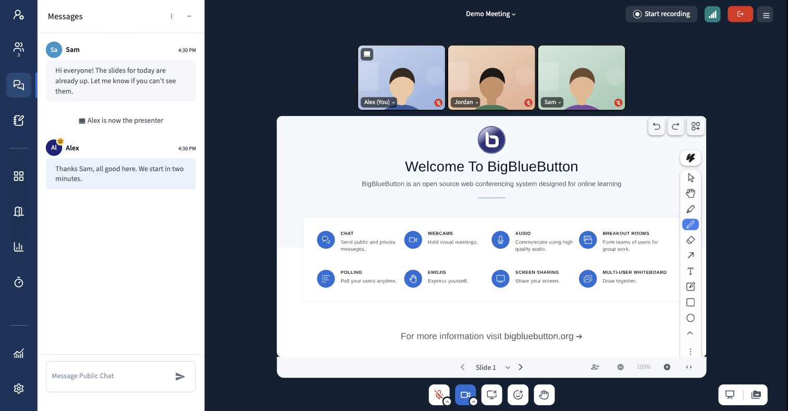
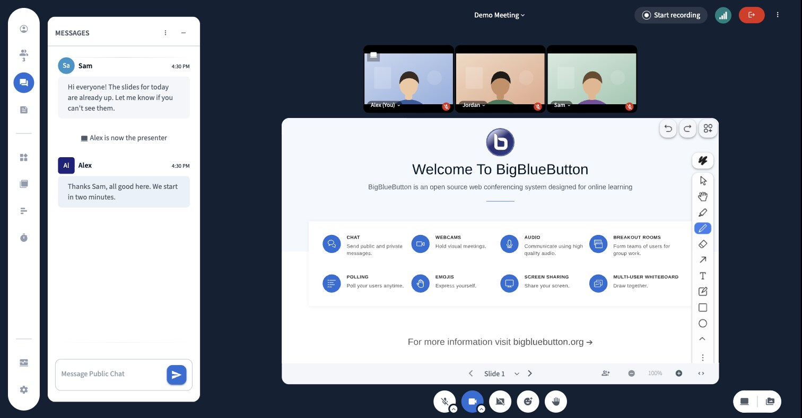

# bbb-plugin-flat-theme

A theme plugin for the BigBlueButton 4.0 HTML5 client. It is pure CSS shipped as a plugin: no client rebuild, no `customStyleUrl`, no extra files to host besides the plugin itself.



## Before and after

The same meeting, same window, with and without the theme.

| Before (default client) |
|---|
|  |

| After (with this plugin) |
|---|
|  |


_Camera images in the screenshots are illustrations._

## What it changes

**Icon bar (left)**
- Full height, no padding and no rounded corners, on a solid blue background.
- Narrower: 72px instead of the client's `60px + 2% of the window`.
- 48px buttons with white icons. The active item gets a lighter background and a marker on the right edge.
- The logo (when there is one) sits on a white tile, so any logo reads well on the dark bar.
- On phones, where the client overlays a 48px bar, buttons shrink to 40px and the list scrolls only vertically, with the scroll shadow drawn in the bar color.

**Sidebar panel (chat, users, notes...)**
- Flush with the icon bar and full height: no padding, no rounded corners, no shadow.
- 64px header with a bottom line, title in regular case.
- Chat input pinned to the bottom, with a thin border. The send button is just the icon.

**Action bar**
- 40px buttons (the size Meet uses) with 10px corners and 20px icons, the same shape as the icon bar buttons. Active buttons (microphone on, hand raised...) are blue with a white icon.
- Muted microphone and camera off show a red icon, so "I am muted" reads at a glance.
- Soft hover on the action and icon bar buttons.
- The presentation and media area buttons stay together in a single capsule, with the same height and corners.

**Cameras**
- Videos fill their tile (`object-fit: cover`, like Meet) instead of showing black bars above and below.
- The name tag over each video gets a darker background and slightly larger text, and the presenter badge gets the same treatment.

**Avatars**
- The client tells moderators apart by a square avatar. Here every avatar is round and moderators get a small gold crown on the top right corner instead, clear of the initials.

**Presentation and notifications**
- The presentation area uses 10px corners, like the cameras and the action bar.
- Notifications use 8px corners and a soft shadow.

**Other buttons and fields**
- Every other button uses 8px corners instead of circles and capsules: top bar (start recording, connection status, leave, options), panels (mute all, polls, timer, breakout rooms, profile), slide navigation and zoom, undo/redo, menus and modals.
- Text fields and selects get the same 8px corners. The small audio device arrow on the microphone stays round.
- Panels get thin, quiet scrollbars.

**Accessibility**
- A visible focus ring for keyboard navigation (`:focus-visible`), the same everywhere.
- Animations and transitions are turned off when the system asks for reduced motion.

**Icons**
- The icon bar and the action bar use [Lucide](https://lucide.dev) icons instead of the `bbb-icons` font: microphone, camera, screen share, reactions, raise hand, profile settings, users, chat, notes, apps, breakout rooms, polls, timer, learning dashboard and settings.
- Icons keep showing the state, like the client does: a crossed microphone when muted, a crossed camera when it is off, a crossed screen when not sharing.
- Icons elsewhere (user list, menus) keep the client defaults.

## Install

1. Build the bundle (or grab `dist/` from a release):

   ```bash
   npm install
   npm run build-bundle
   ```

2. Copy `dist/` to a folder served by nginx on the BigBlueButton server, for example:

   ```bash
   sudo mkdir -p /var/www/bigbluebutton-default/assets/plugins/bbb-plugin-flat-theme
   sudo cp dist/* /var/www/bigbluebutton-default/assets/plugins/bbb-plugin-flat-theme/
   ```

3. Add the manifest to `pluginManifests` in `/etc/bigbluebutton/bbb-web.properties` (keep the other plugins you already have in the list):

   ```properties
   pluginManifests=[{"url":"https://<your-server>/plugins/bbb-plugin-flat-theme/manifest.json"}]
   ```

4. Restart bbb-web: `sudo systemctl restart bbb-web`. Meetings created from then on load the theme.

To try it on a single meeting instead, pass the manifest on the `create` call: `pluginManifests=[{"url":"https://<your-server>/plugins/bbb-plugin-flat-theme/manifest.json"}]`.

If you used a `customStyleUrl` before, remove it from `/etc/bigbluebutton/bbb-html5.yml` and restart `bbb-apps-akka` as well: the client settings are stored per meeting by akka-apps, which only reads that file on startup.

## Customizing

Colors and the icon bar width are CSS variables at the top of [`src/theme.css`](src/theme.css):

| Variable | Default | Used for |
|---|---|---|
| `--theme-background` | `#102133` | Background behind the presentation, top bar and action bar |
| `--theme-nav` | `#133459` | Icon bar |
| `--theme-nav-active` | `#1E4877` | Active item in the icon bar |
| `--theme-primary` | `#0F70D7` | Active marker, active buttons, focus ring |
| `--theme-danger` | `#D93025` | Muted microphone and camera off |
| `--theme-moderator` | `#F5B700` | Moderator crown badge |
| `--theme-nav-width` | `72px` | Icon bar width |

Change them and rebuild.

## How it works

The plugin imports `src/theme.css` through `style-loader`, which injects it into `<head>` when the bundle loads. SVG icons are inlined as data URIs, so the plugin is a single JS file. The React component only calls `BbbPluginSdk.initialize()` so the client reports the plugin as loaded.

Some details worth knowing if you change the CSS:

- The client positions the icon bar, sidebar panel, presentation and action bar in JS, with inline `left`/`top`/`width`/`height`. The theme only changes padding, color, border, radius and inner sizes. To make the icon bar narrower, the sidebar panel moves left by the difference and grows by the same amount, so it still meets the presentation.
- The narrower icon bar only applies on screens with a mouse (`pointer: fine`, at least 768px wide). On phones the client uses a different width (48px), so the bar is left alone there.
- Selectors use `data-test` attributes and ids, because styled-components class names change on every client build.
- Icons replace the `::before` glyph of the `icon-bbb-*` classes with an SVG used as a mask, so they still follow the text color.

Tested on BigBlueButton 4.0.0 with plugin SDK `1.0.0-beta`.

The theme targets the client's light mode. On the test server, turning on the client's own dark mode (Settings, Application) left the whole screen blank even with this plugin removed, so dark mode was not styled.

## License

MIT, see [LICENSE](LICENSE). Icons are from [Lucide](https://lucide.dev), ISC license, see [src/icons/LICENSE](src/icons/LICENSE).
