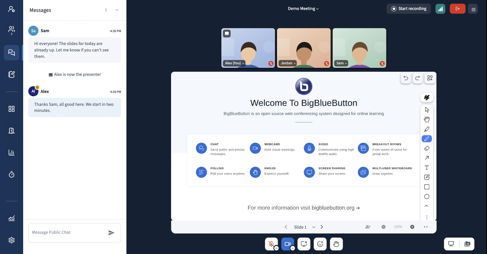
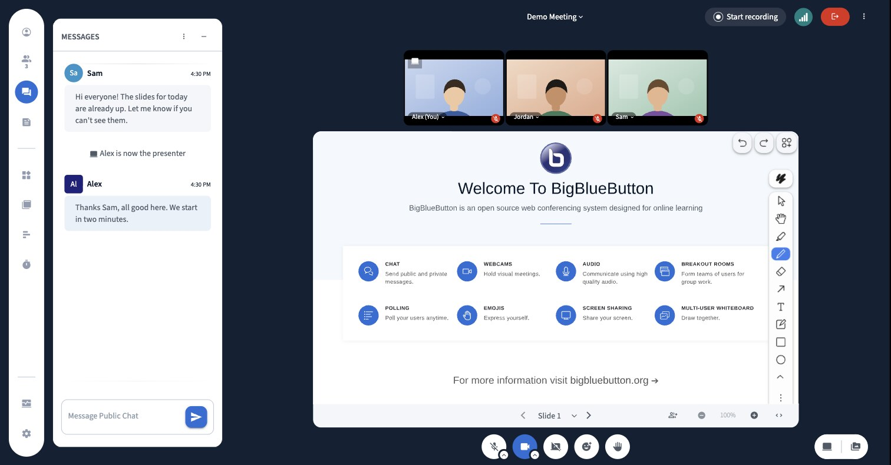
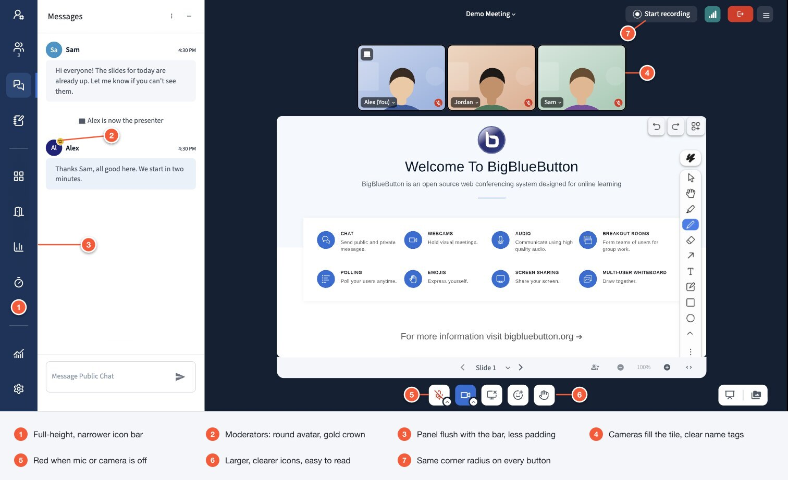

# bbb-plugin-flat-theme

A theme plugin for the BigBlueButton 4.0 HTML5 client. It is pure CSS, so you can use it in two ways:

- **As a plugin** (`pluginManifests`): no client rebuild and nothing else to configure.
- **As a plain stylesheet** (`customStyleUrl`): one static `theme.css` with every icon inlined, if you would rather not run a plugin. See [Use it as a custom style](#use-it-as-a-custom-style-css-only).

> **Requires BigBlueButton 4.0.1 or later.** The theme styles the client through its static `bbb-*` classes (`bbb-avatar--presenter`, `bbb-navigation__item--active`...), added in 4.0.1 ([#26193](https://github.com/bigbluebutton/bigbluebutton/pull/26193)). For 4.0.0, use the [`bbb-4.0.0`](https://github.com/gustavotrott/bbb-plugin-flat-theme/tree/bbb-4.0.0) branch, which styles it through `data-test` attributes and the DOM structure.



## Before and after

The same meeting, same window, with and without the theme.

| Before (default client) |
|---|
|  |

| After (with this plugin) |
|---|
|  |


_Camera images in the screenshots are illustrations._

## What it changes

**Icon bar (left)**
- Full height, no padding and no rounded corners, on a solid blue background.
- Narrower: 72px instead of the client's `60px + 2% of the window`.
- 48px buttons with white icons. The active item gets a lighter background and a marker on the right edge.
- The logo (when there is one) sits on a white tile, so any logo reads well on the dark bar.
- On phones, where the client overlays a 48px bar, buttons shrink to 40px and the list scrolls only vertically, with the scroll shadow drawn in the bar color.

**Sidebar panel (chat, users, notes...)**
- Flush with the icon bar and full height: no padding, no rounded corners, no shadow.
- 64px header with a bottom line, title in regular case.
- Chat input pinned to the bottom, with a thin border. The send button is just the icon.

**Action bar**
- 40px buttons (the size Meet uses) with 10px corners and 20px icons, the same shape as the icon bar buttons. Active buttons (microphone on, hand raised...) are blue with a white icon.
- Muted microphone and camera off show a red icon, so "I am muted" reads at a glance.
- Soft hover on the action and icon bar buttons, keeping the icon dark (the client turns it white for its darker hover).
- The presentation and media area buttons stay together in a single capsule, with the same height and corners.

**Cameras**
- Videos fill their tile (`object-fit: cover`, like Meet) instead of showing black bars above and below, also while the person is speaking. In fullscreen the whole image is shown, without cropping.
- The name tag over each video gets a darker background and slightly larger text, and the presenter badge gets the same treatment.

**Avatars**
- The client tells moderators apart by a square avatar. Here every avatar is round and moderators get a small gold crown on the top right corner instead, clear of the initials.
- In the user list, the presenter gets a small blue presentation badge on the bottom right corner. The chat does not get it: its messages carry no user id, only the avatar color, which can repeat.

**Top bar**
- The options button (top right) shows a menu icon on a light tile, matching the connection and leave buttons beside it, instead of three bare dots.

**Presentation and notifications**
- The presentation area uses 10px corners, like the cameras and the action bar.
- Notifications use 8px corners and a soft shadow.

**Other buttons and fields**
- Every other button uses 8px corners instead of circles and capsules: top bar (start recording, connection status, leave, options), panels (mute all, polls, timer, breakout rooms, profile), slide navigation and zoom, undo/redo, menus and modals.
- Text fields and selects get the same 8px corners. The small audio device arrow on the microphone stays round.
- Panels get thin, quiet scrollbars.
- If [bbb-plugin-reaction-stack](https://github.com/bigbluebutton/bbb-plugin-reaction-stack) is installed, its reaction pills get the theme's 10px corners instead of round capsules (through its `--reaction-stack-radius` variables).

**Accessibility**
- A visible focus ring for keyboard navigation (`:focus-visible`), the same everywhere.
- Animations and transitions are turned off when the system asks for reduced motion.

**Icons**
- The icon bar and the action bar use [Lucide](https://lucide.dev) icons instead of the `bbb-icons` font: microphone, camera, screen share, reactions, raise hand, profile settings, users, chat, notes, apps, breakout rooms, polls, timer, learning dashboard and settings.
- The user list (row buttons, search, download) and the dropdown menus (user options, audio devices, options, presentation) use them too. "Make moderator" shows the same crown the moderator avatars get, "Remove user" a user with an x, "End meeting" a power icon.
- Icons keep showing the state, like the client does: a crossed microphone when muted, a crossed camera when it is off, a crossed screen when not sharing, a crossed presentation when it is minimized.
- Icons elsewhere keep the client defaults.

## Try it without installing

The plugin is hosted on GitHub Pages. Pass its manifest when you create a meeting, and that meeting loads the theme with nothing installed on the server:

```text
pluginManifests=[{"url":"https://gustavotrott.github.io/bbb-plugin-flat-theme/manifest.json"}]
```

You can add it to the `create` call in [API Mate](https://mconf.github.io/api-mate/) or in your own integration. The BigBlueButton server reads the manifest when the meeting is created, so it must reach `github.io`. The participants' browsers load the plugin from there too.

## Install on your server

These steps install from the latest [release](https://github.com/gustavotrott/bbb-plugin-flat-theme/releases/latest).

1. Download it into a folder served by nginx:

   ```bash
   sudo mkdir -p /var/www/bigbluebutton-default/assets/plugins/bbb-plugin-flat-theme
   curl -fsSL https://github.com/gustavotrott/bbb-plugin-flat-theme/releases/latest/download/bbb-plugin-flat-theme.tar.gz \
     | sudo tar xz --no-same-owner -C /var/www/bigbluebutton-default/assets/plugins/bbb-plugin-flat-theme
   ```

2. Add the manifest to `pluginManifests` in `/etc/bigbluebutton/bbb-web.properties`. Keep the other plugins you already have in the list:

   ```properties
   pluginManifests=[{"url":"https://<your-server>/plugins/bbb-plugin-flat-theme/manifest.json"}]
   ```

3. Restart bbb-web:

   ```bash
   sudo systemctl restart bbb-web
   ```

Meetings created from then on load the theme. To update, run step 1 again. No restart is needed.

You can skip the download and put the GitHub Pages manifest (`https://gustavotrott.github.io/bbb-plugin-flat-theme/manifest.json`) in `bbb-web.properties` instead. The theme then always follows the latest version on `main`.

If you used a `customStyleUrl` before, remove it from `/etc/bigbluebutton/bbb-html5.yml` and restart `bbb-apps-akka` as well: the client settings are stored per meeting by akka-apps, which only reads that file on startup.

## Use it as a custom style (CSS only)

The build also writes `dist/theme.css`: the same theme as one static stylesheet, with the icons inlined as data URIs. The client adds it as a `<link rel="stylesheet">`, so nothing runs besides the CSS. Use the plugin or the stylesheet, not both.

The stylesheet is on GitHub Pages at `https://gustavotrott.github.io/bbb-plugin-flat-theme/theme.css`, and every release attaches it as `theme.css`.

**For one user**, pass it on the `join` call:

```text
userdata-bbb_custom_style_url=https://gustavotrott.github.io/bbb-plugin-flat-theme/theme.css
```

**For the whole server**, host it yourself (or use the GitHub Pages URL):

1. Download it into a folder served by nginx:

   ```bash
   sudo mkdir -p /var/www/bigbluebutton-default/assets/plugins/bbb-plugin-flat-theme
   sudo curl -fsSL -o /var/www/bigbluebutton-default/assets/plugins/bbb-plugin-flat-theme/theme.css \
     https://github.com/gustavotrott/bbb-plugin-flat-theme/releases/latest/download/theme.css
   ```

2. Set `public.app.customStyleUrl` in `/etc/bigbluebutton/bbb-html5.yml`:

   ```yaml
   public:
     app:
       customStyleUrl: https://<your-server>/plugins/bbb-plugin-flat-theme/theme.css
   ```

3. Restart BigBlueButton (`sudo bbb-conf --restart`). The client settings are stored per meeting by akka-apps, which only reads `bbb-html5.yml` on startup.

Meetings created from then on load the stylesheet. To update, run step 1 again.

## Build from source

```bash
npm ci
npm run build-bundle
sudo mkdir -p /var/www/bigbluebutton-default/assets/plugins/bbb-plugin-flat-theme
sudo cp dist/* /var/www/bigbluebutton-default/assets/plugins/bbb-plugin-flat-theme/
```

Then follow steps 2 and 3 of [Install on your server](#install-on-your-server). `npm run build-bundle` also writes `dist/theme.css`; `npm run build-css` writes only that file.

## Customizing

Colors and the icon bar width are CSS variables at the top of [`src/theme.css`](src/theme.css):

| Variable | Default | Used for |
|---|---|---|
| `--theme-background` | `#102133` | Background behind the presentation, top bar and action bar |
| `--theme-nav` | `#133459` | Icon bar |
| `--theme-nav-active` | `#1E4877` | Active item in the icon bar |
| `--theme-primary` | `#0F70D7` | Active marker, active buttons, focus ring |
| `--theme-danger` | `#D93025` | Muted microphone and camera off |
| `--theme-moderator` | `#F5B700` | Moderator crown badge |
| `--theme-nav-width` | `72px` | Icon bar width |

Change them and rebuild.

## How it works

The plugin imports `src/theme.css` through `style-loader`, which injects it into `<head>` when the bundle loads. SVG icons are inlined as data URIs, so the plugin is a single JS file. The React component only registers the plugin: the client marks the presenter's avatar with `bbb-avatar--presenter`, and the badge is drawn in `theme.css`.

Some details worth knowing if you change the CSS:

- The client positions the icon bar, sidebar panel, presentation and action bar in JS, with inline `left`/`top`/`width`/`height`. The theme only changes padding, color, border, radius and inner sizes. To make the icon bar narrower, the sidebar panel moves left by the difference and grows by the same amount, so it still meets the presentation.
- The narrower icon bar only applies on screens with a mouse (`pointer: fine`, at least 768px wide). On phones the client uses a different width (48px), so the bar is left alone there.
- Selectors use the client's static `bbb-*` classes (`block`, `block__element`, `block--state`), because styled-components class names change on every client build. A few elements without one still go by their `data-test` attribute.
- Icons replace the `::before` glyph of the `icon-bbb-*` classes with an SVG used as a mask, so they still follow the text color.

Tested on BigBlueButton 4.0.2 (`v4.0.x-develop` of 30/10/2026) with plugin SDK `1.0.0-beta`.

The theme targets the client's light mode. On the test server, turning on the client's own dark mode (Settings, Application) left the whole screen blank even with this plugin removed, so dark mode was not styled.

## Releases

Every push to `main` publishes `dist/` (plugin and `theme.css`) on GitHub Pages. Pushing a `v*` tag, with the same version as `package.json` and `manifest.json`, builds the plugin and attaches `bbb-plugin-flat-theme.tar.gz` and `theme.css` to a GitHub release.

## More themes

[bbb-plugin-themes](https://github.com/gustavotrott/bbb-plugin-themes) has seven more themes built on this one: Cozy, Kids, Light, Midnight, Synthwave, Moodle and School (K-12).

## License

MIT, see [LICENSE](LICENSE). Icons are from [Lucide](https://lucide.dev), ISC license, see [src/icons/LICENSE](src/icons/LICENSE).
